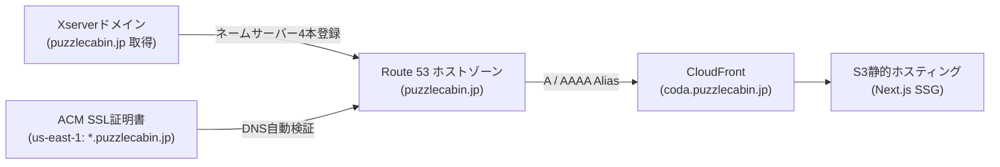

# Route 53 パブリックホストゾーン（puzzlecabin.jp）＆ サブドメイン（coda.puzzlecabin.jp）セットアップ手順書

本手順書では、「アルゴ（algo）Web対戦システム」を独自ドメインのサブドメイン **`https://coda.puzzlecabin.jp`** で一般公開するために、**Xserverドメインで取得したドメイン `puzzlecabin.jp`** を **Amazon Route 53** に委任し、**CloudFront + ACM (SSL証明書)** と連携する手順をステップバイステップで解説します。

---

## 構成概要

- **Apex / ルートドメイン**: `puzzlecabin.jp` (Xserverドメインで取得)
- **ネームサーバー管理**: Amazon Route 53 パブリックホストゾーン（CloudFormation で IaC 一元管理）
- **本アプリ公開サブドメイン**: `coda.puzzlecabin.jp`（CloudFront A / AAAA エイリアスレコードで高速配信）
- **SSL/TLS証明書**: AWS Certificate Manager (ACM, `us-east-1` バージニア北部)
  - ドメイン名: `*.puzzlecabin.jp` および `puzzlecabin.jp`



---

## ステップ 1: CloudFormation スタックのデプロイ / 更新

本リポジトリの `infrastructure/cloudformation/main.yaml` は Route 53 ホストゾーンの自動作成に対応しています。

1. AWSマネジメントコンソールにログインし、**東京リージョン (`ap-northeast-1`)** の **CloudFormation** コンソールを開きます。
2. 既存の `algo-prod` スタックを選択し、「更新（Update）」＞「現在のテンプレートを置き換える」から最新の `main.yaml` をアップロード（またはAWS CLIでデプロイ）します。
3. パラメータを以下のように設定します：
   - **`ManageRoute53Zone`**: `true`（デフォルト）
   - **`RootDomainName`**: `puzzlecabin.jp`（デフォルト）
   - **`AppSubdomain`**: `coda`（デフォルト）
   - **`CustomDomainName`**: `coda.puzzlecabin.jp`（デフォルト）
   - **`AcmCertificateArn`**: 初回は空文字 `''` のままでOK（ステップ3で証明書取得後に設定します）
4. スタック更新を実行し、完了するまで待ちます（約1〜2分）。

---

## ステップ 2: Route 53 ネームサーバー 4 本の確認 ＆ Xserver への委任

1. CloudFormation の更新が完了したら、「出力（Outputs）」タブを開きます。
2. 以下の出力を確認・コピーします：
   - **`HostedZoneId`**: 例 `Z0123456789ABCDEF`
   - **`HostedZoneNameServers`**: 4本のネームサーバー（例: `ns-123.awsdns-15.com, ns-456.awsdns-57.net, ns-789.awsdns-34.org, ns-1011.awsdns-12.co.uk`）
3. **Xserverドメイン管理パネルでの設定**:
   1. [Xserverドメイン管理パネル](https://secure.xserver.ne.jp/xapanel/login/xdomain/) にログインします。
   2. 対象ドメイン `puzzlecabin.jp` の「ネームサーバー設定」をクリックします。
   3. 「設定対象」で **「その他のネームサーバーを利用する」** を選択します。
   4. ネームサーバー 1 〜 4 に、上記でコピーした Route 53 のネームサーバーを 1 本ずつ入力します：
      - **ネームサーバー 1**: `ns-xxx.awsdns-xx.com`
      - **ネームサーバー 2**: `ns-xxx.awsdns-xx.net`
      - **ネームサーバー 3**: `ns-xxx.awsdns-xx.org`
      - **ネームサーバー 4**: `ns-xxx.awsdns-xx.co.uk`
      *(※ 末尾にドット `.` がある場合は削除して入力してください)*
   5. 「確認画面へ進む」＞「設定を変更する」をクリックして保存します。
   > ⏳ **DNS反映の目安**: 世界中のDNSキャッシュサーバーへの浸透には数分〜最大24時間程度かかりますが、通常15〜30分程度で名前解決が可能になります。

---

## ステップ 3: ACM (AWS Certificate Manager) で無料SSL証明書を発行

CloudFront で独自ドメインを利用するため、米国東部（バージニア北部）リージョンで無料のパブリックSSL証明書を発行します。

1. AWSコンソール右上のリージョン選択を **必ず「米国東部（バージニア北部）`us-east-1`」** に切り替えます。
   > ⚠️ **重要**: CloudFront にアタッチする ACM 証明書は **`us-east-1`** で作成する必要があります。東京リージョン等で作成した証明書は CloudFront にアタッチできません。
2. **AWS Certificate Manager (ACM)** コンソールを開き、「証明書をリクエスト」をクリックします。
3. 「パブリック証明書をリクエスト」を選択し、「次へ」をクリックします。
4. **完全修飾ドメイン名 (FQDN)**:
   - 1つ目: `*.puzzlecabin.jp`（ワイルドカード: 将来の他サブドメインでも共通利用可能）
   - 「この証明書に別の名前を追加」をクリックし、2つ目: `puzzlecabin.jp`（ルートドメイン）も追加
5. **検証方法**: **「DNS検証」** を選択し、「リクエスト」をクリックします。
6. リクエスト完了後、作成された証明書の詳細ページを開きます。
7. 「ドメイン」欄のテーブル右上にある **「Route 53 でレコードを作成 (Create records in Route 53)」** ボタンをクリックします。
8. 表示されるレコード一覧を確認し、「レコードを作成」をクリックします。
   - Route 53 パブリックホストゾーンに自動的に検証用 CNAME レコードが登録されます。
9. 1〜3分程度でステータスが **「保留中の検証 (Pending validation)」** から **「発行済み (Issued)」** に変わります。
10. 証明書の **ARN**（例: `arn:aws:acm:us-east-1:330631893499:certificate/xxxxxxxx-xxxx-xxxx-xxxx-xxxxxxxxxxxx`）をコピーします。

---

## ステップ 4: CloudFormation に ACM 証明書を反映し CloudFront ＆ DNS を有効化

1. 再びリージョンを **東京 (`ap-northeast-1`)** に戻し、CloudFormation コンソールを開きます。
2. スタックを選択し、「更新（Update）」＞「現在のテンプレートを使用」をクリックします。
3. パラメータの **`AcmCertificateArn`** に、ステップ 3 でコピーした ACM 証明書の ARN を貼り付けます：
   - `AcmCertificateArn`: `arn:aws:acm:us-east-1:330631893499:certificate/xxxxxxxx-xxxx-xxxx-xxxx-xxxxxxxxxxxx`
4. 更新を実行します（CloudFront ディストリビューションの更新と Route 53 A/AAAA エイリアスレコードの作成が行われ、約3〜5分で完了します）。
5. Outputs に表示される **`AppUrl`** が `https://coda.puzzlecabin.jp` になっていることを確認します。

---

## ステップ 5: DNS 伝播確認コマンド

PC のターミナル（PowerShell / Bash / Command Prompt）から以下のコマンドを実行し、DNS が正常に引けることを確認します。

### 1. ネームサーバー委任の確認 (NSレコード)
```bash
nslookup -type=NS puzzlecabin.jp
```
*Route 53 の `awsdns` サーバーが返ってくれば委任成功です。*

### 2. サブドメインの解決確認 (A / AAAAレコード)
```bash
nslookup coda.puzzlecabin.jp
```
*CloudFront の IP アドレス群が返ってくれば名前解決完了です。*

macOS / Linux / WSL では `dig` コマンドも利用可能です：
```bash
dig coda.puzzlecabin.jp +short
dig coda.puzzlecabin.jp AAAA +short
```

### 3. ブラウザでのアクセス確認
ブラウザで [https://coda.puzzlecabin.jp](https://coda.puzzlecabin.jp) にアクセスし、鍵マーク（SSL/TLS保護）が表示され、ゲームが正常に動作することを確認します。

---

## ステップ 6: GitHub Actions Variables の設定

GitHub Actions CI/CD が本番デプロイ時に正しい本番 URL でビルド（OGP、Sitemap、Canonical URL、JSON-LD）できるよう、GitHub リポジトリの変数を設定します。

1. GitHub リポジトリの **Settings > Secrets and variables > Actions > Variables** タブを開きます。
2. 「New repository variable」をクリックし、以下を登録（または更新）します：
   - **Name**: `NEXT_PUBLIC_SITE_URL`
   - **Value**: `https://coda.puzzlecabin.jp`

---

## 留意事項: Route 53 コストと FinOps ゼロコストガード

- **Route 53 パブリックホストゾーン費用**:
  - ホストゾーン 1 つあたり **月額 $0.50** の固定費が発生します（CloudFront 宛ての DNS エイリアスクエリは無料です）。
  - 本リポジトリの AWS Budgets は `$0.01` 課金アラート（`algo-prod-zero-cost-guard`）が設定されているため、ホストゾーン作成後にアラート通知メールが届くことがあります。これは正常な挙動ですのでご安心ください。
  - 必要に応じて、AWS Budgets の閾値を `$1.00` 等へ変更することも可能です。
